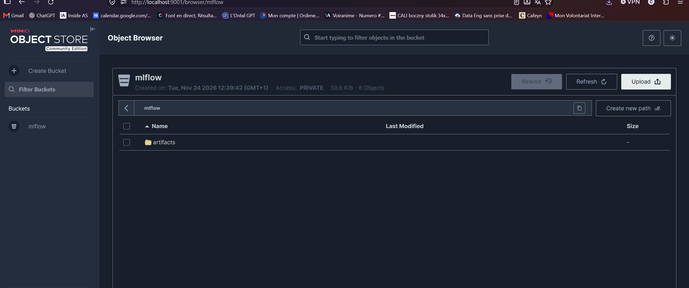
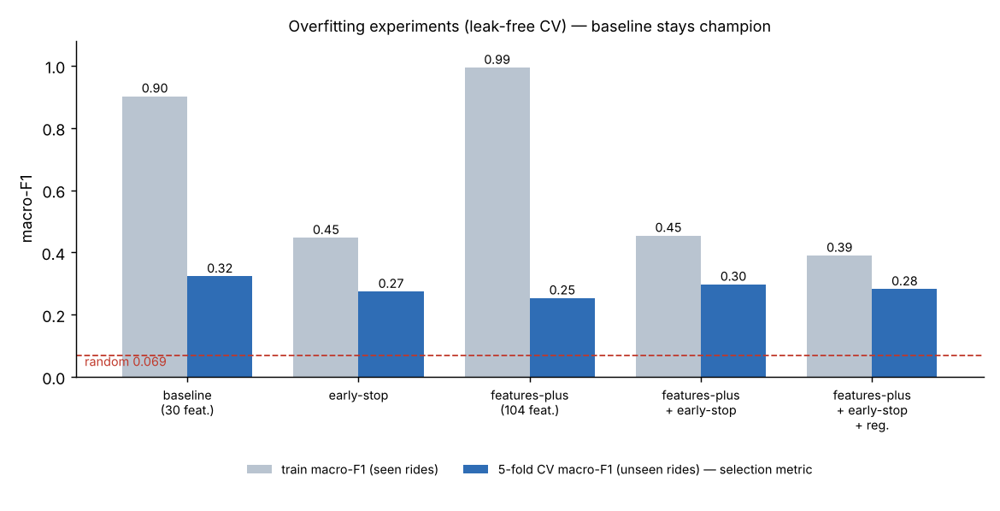
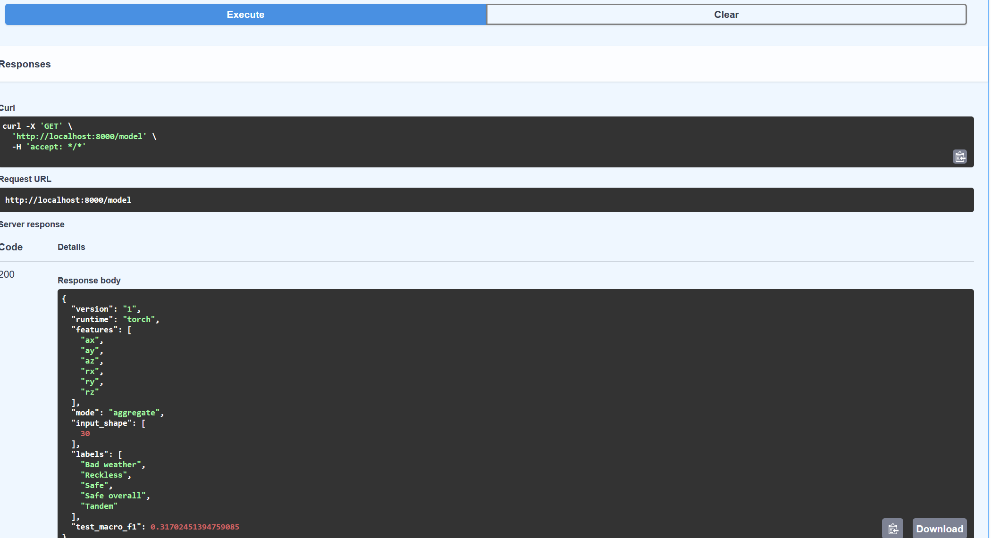
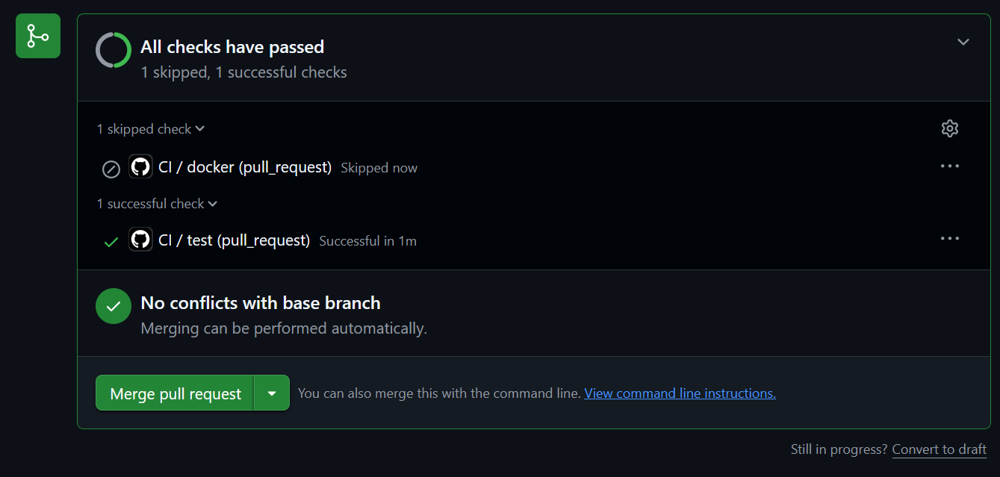
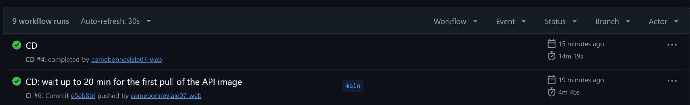
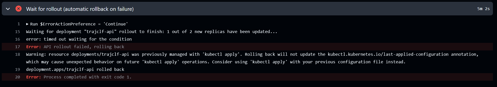
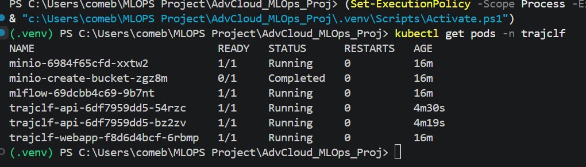
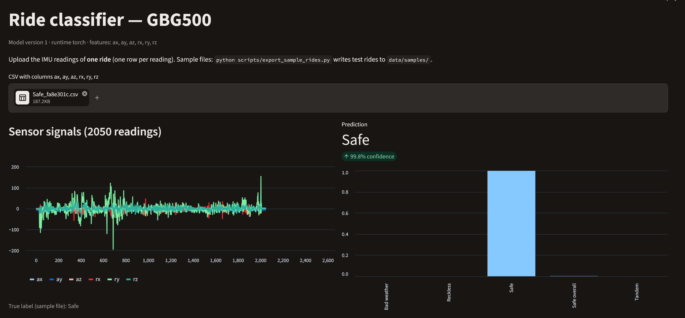
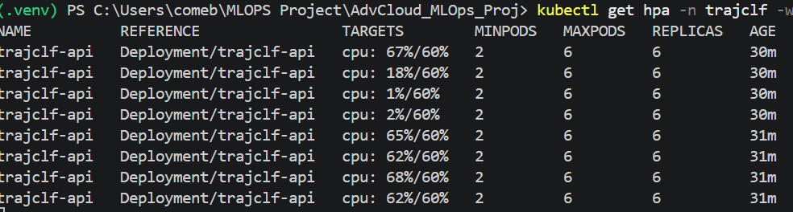
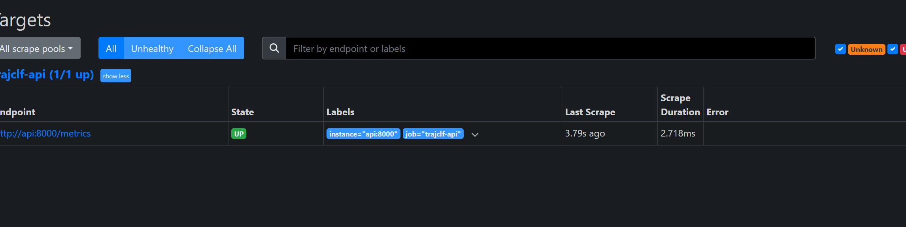

# Ride classification — MLOps pipeline + AI Infrastructure

Classifies e-scooter/bike **rides** (IMU readings: accelerometer `ax ay az`, gyroscope `rx ry rz`)
into 5 classes: **Safe, Safe overall, Bad weather, Tandem, Reckless** (GBG500 dataset, 500 rides).

One repository, two courses:
* **MLOps** — preprocessing, training, MLflow tracking + registry, model storage on S3 (MinIO),
  FastAPI, web app, Docker, Kubernetes, GitHub Actions CI/CD, retraining pipeline, monitoring.
* **AI Infrastructure** — resource sizing, inference benchmark, ONNX/INT8 optimization,
  distributed-training decision, scaling/cost/rollback plan → [`ai-infrastructure/`](ai-infrastructure/README.md).

Team: *Name 1, Name 2, Name 3, Name 4, Name 5*

## Architecture


| Step | Tool | Code |
|---|---|---|
| Data extraction & checks | pandas / pyarrow | `research/inspect_data.py`, `research/check_rides.py` |
| Preprocessing | duplicates averaged, NaN-aware stats, stratified ride split (80/20, seed 42) | `src/trajclf/data.py` |
| Model | PyTorch — `mlp` (30 aggregate features, default) or `cnn` (1024×6 sequence) | `src/trajclf/model.py`, `configs/*.yaml` |
| Tracking & registry | MLflow; best model gets alias `@champion` (gate: leak-free 5-fold CV macro-F1, the test split never decides) | `src/trajclf/train.py` |
| Model storage | MinIO (S3) as MLflow artifact store; bundle = TorchScript + ONNX + preprocessing | `src/trajclf/bundle.py` |
| API | FastAPI + Swagger (`/docs`), Prometheus metrics (`/metrics`) | `src/trajclf/api/main.py` |
| Web app | Streamlit: upload a ride CSV, see signals + prediction | `webapp/app.py` |
| Containers | Docker images api / webapp / train | `Dockerfile.*`, `docker-compose.yml` |
| Production | Docker Desktop Kubernetes: Deployment, Service, HPA, CronJob | `k8s/` |
| CI/CD | GitHub Actions: lint + tests → images on Docker Hub → deploy (self-hosted runner) with auto-rollback | `.github/workflows/` |
| Retraining pipeline (bonus) | data from S3 → train → register → promote if better → redeploy | `.github/workflows/retrain.yml`, `scripts/data_s3.py`, `pipelines/dags/` |
| Monitoring (bonus) | Prometheus + Grafana dashboard (latency, errors, class mix, confidence, input drift) | `monitoring/` |

## Technical choices

* **Supervised learning** on GBG500 labels (confirmed with the teacher, see `docs/FINDINGS.md`);
  `SRV3490` (crash data) is not used for the 5-class task.
* **Imbalance** (Safe 416 vs Reckless 6): class-weighted cross-entropy; **macro-F1** as the main
  metric; accuracy alone is misleading (always predicting Safe gives 0.83).
* **Same held-out test split as the research phase** (100 rides), so MLflow runs compare directly
  with `docs/FINDINGS.md`: always-Safe macro-F1 0.18, random forest 0.36, first MLP 0.23
  (exploratory). The pipeline also logs a random-guess baseline to check "better than random".
* **Preprocessing inside the model bundle** (`preprocess.json`): the API and training apply the
  same transformation, so there is no training/serving skew.
* **TorchScript + ONNX export** in every bundle: the API needs no model class, and the runtime can
  be switched (`MODEL_RUNTIME=torch|onnx|onnx-int8`) for the AI-infra optimization.

## Quick start (dev)

```bash
pip install -r requirements-dev.txt
# put Project.zip content in data/raw/  (GBG500.parquet, GBG500_labels.csv) — git-ignored
docker compose up -d minio mlflow     # MinIO :9001, MLflow :5000
make data train                                  # preprocess, train, log, register, promote
docker compose up -d                             # API :8000/docs, web app :8501, Grafana :3000
python scripts/export_sample_rides.py            # test rides as CSV for the web app
```

No data? `make synthetic` generates fake rides with the same schema (for tests only).
Sequence model: `TRAJCLF_CONFIG=configs/config.cnn.yaml make data train`.

## Production (local Kubernetes)

```bash
kubectl apply -k k8s/                            # MinIO, MLflow, API (x2 + HPA), web app, retrain CronJob
kubectl -n trajclf port-forward svc/mlflow 5000 & kubectl -n trajclf port-forward svc/minio 9000 &
make data train                                  # registers @champion in the cluster's MLflow
kubectl -n trajclf rollout restart deploy/trajclf-api
helm install monitoring prometheus-community/kube-prometheus-stack -n monitoring --create-namespace -f k8s/monitoring-values.yaml
```

The CD workflow runs these steps on a self-hosted runner. Configure repository secrets:
`DOCKERHUB_USERNAME`, `DOCKERHUB_TOKEN`, `MINIO_USER`, `MINIO_PASSWORD`.

> **Note on MinIO images.** MinIO withdrew its public images from Docker Hub and quay.io in September
> 2026, so `minio/minio` and `minio/mc` no longer pull. The stack uses `cgr.dev/chainguard/minio`
> (a build of the same MinIO server) and creates buckets with boto3 instead of `mc`.

## Tests

```bash
make test                     # unit + integration (synthetic data, no server needed)
API_URL=http://localhost:8000 pytest -m e2e   # against a running API
```

## Docker images

* API: https://hub.docker.com/r/comebnvl/trajclf-api
* Web app: https://hub.docker.com/r/comebnvl/trajclf-webapp
* Training / retraining job: https://hub.docker.com/r/comebnvl/trajclf-train

## Results

### Model quality (100 held-out test rides, same split as `docs/FINDINGS.md`)

| Model | Macro-F1 | Accuracy | Notes |
|---|---|---|---|
| Random guess | 0.069 | — | logged by `train.py` |
| Always "Safe" | 0.18 | 0.83 | research baseline |
| Random forest (research) | 0.36 | 0.80 | `research/train_baseline.py` |
| **RideMLP — MLflow `trajectory-classifier` v14 `@champion` (served)** | **0.230** | — | 4,229 parameters, leak-free 5-fold CV macro-F1 **0.323**, train 0.90 |

The served model is 3× better than random on the test rides and well above it in cross-validation
(0.32 vs 0.07). With only 6 Reckless rides in the whole dataset (1 in the test split), the 100-ride
test score is noisy (0.23–0.32 across runs of the same MLP), which is why the champion is chosen on
5-fold cross-validation over the 400 training rides and the test split is only reported.

### Experiment tracking and model storage

Every run is tracked in MLflow (parameters, per-epoch curves, CV / train / test scores, hardware) and
registered as a new version of `trajectory-classifier`; only the best one carries the alias `champion`
(first runs shown below, 18 versions today):


**Model artifacts stored on MinIO (S3 bucket `mlflow`)**



### Data leakage found and fixed

Two leaks inflated the selection score:
1. **Scaling inside cross-validation** — the mean/std used to standardise features were fitted on all
   400 training rides, so each held-out fold had already been "seen" by the scaler. Fix: the scaler is
   re-fitted inside every fold on the fitting rides only (`fold_standardise`, `cross_validate`).
2. **Test split used to pick the champion** when no CV score was available. Fix: promotion uses the
   CV score only (`selection_metric`); a run without CV is registered but never promoted.

Same model, same seed, before/after the fix: CV macro-F1 **0.333 → 0.323**. Old champions selected
with the leaky protocol have no `cv_protocol` tag and can no longer block a leak-free model
(`promote_if_better`). Regression tests: `tests/unit/test_selection_and_cv.py`.

### Overfitting experiments (sweep, leak-free CV)

The baseline MLP learns the training rides by heart (train 0.90 vs CV 0.32). Two remedies were
tested with `scripts/sweep.py` (each variant = one MLflow run): **early stopping** (15 % of the
training rides held out, patience 20, best epoch restored) and **104 driving-style features**
(`data.mode=aggregate_plus`: acceleration/rotation magnitudes, percentiles, jerk, peak rate).



| Variant | CV macro-F1 (selection) | Train macro-F1 | Gap |
|---|---|---|---|
| **baseline (champion)** | **0.323** | 0.90 | 0.58 |
| early-stop | 0.274 | 0.45 | 0.17 |
| features-plus | 0.253 | 0.99 | 0.74 |
| features-plus + early-stop | 0.297 | 0.45 | 0.16 |
| features-plus + early-stop + dropout 0.5 / weight decay 1e-3 | 0.282 | 0.39 | 0.11 |

Early stopping shrinks the gap but stops too early (≈60 rides fewer to learn from, and a noisy stop
signal with 4–5 Reckless rides): the model underfits and generalises worse. More features give the
MLP more capacity to memorise. **Conclusion: the ceiling comes from the data (500 rides, 6 Reckless),
not from the training settings**; the baseline stays champion and both options remain available in
`configs/config.yaml` (`data.mode`, `train.early_stopping_patience`) for future data.

### API (FastAPI + Swagger)



### CI on GitHub Actions

Every pull request runs `.github/workflows/ci.yml`: ruff lint + unit/integration tests (training, ONNX export,
API) on a clean Ubuntu runner. Docker images are built and pushed to Docker Hub only on `main`.



### Continuous deployment with automatic rollback

`.github/workflows/cd.yml` runs after every green CI on `main`, on a self-hosted Windows runner that
can reach the local cluster: `kubectl apply -k k8s/` with the images tagged with the **commit SHA**
(one single rollout, traceable with `kubectl rollout history`), wait for the rollout, smoke test
`/health` and `/model`, and `kubectl rollout undo` if any step fails.



The rollback was exercised for real: the ~600 MB API image (PyTorch) took longer to pull than the
rollout deadline, the CD failed and Kubernetes went back to the previous version with **no downtime**
(`maxUnavailable: 0`, the old pods kept serving). Fix: `progressDeadlineSeconds: 1800` and a single
SHA-tagged rollout instead of `:latest` followed by `set image`. Next step: an ONNX-only API image
(no PyTorch, ≈4× smaller) to make pulls fast.



### Retraining pipeline (bonus 1)

`.github/workflows/retrain.yml` — button in the Actions tab or every Monday 03:00 UTC, on the
self-hosted runner:

1. download the dataset from the S3 bucket `data/gbg500` (MinIO, `scripts/data_s3.py`);
2. preprocess, retrain with 5-fold CV, log the run and register a new model version in MLflow;
3. move `@champion` only if the CV macro-F1 beats the current champion;
4. if promoted, `kubectl rollout restart` the API, which loads the new champion from MLflow
   (rollback if the rollout fails).

First run (`retrain-1`, 9 min 56 s, of which ~8 min installing the Python environment once):
version 13 registered, CV 0.323, **not promoted** (not better than the champion), so nothing was
redeployed — the expected behaviour. New data only needs `python scripts/data_s3.py upload`.

### Production on Kubernetes (Docker Desktop)

`kubectl apply -k k8s/` — MinIO, MLflow, API (2 replicas, rolling update, HPA 2→6), web app, retraining CronJob:



Web app running in the cluster, calling the API pods:



### Autoscaling tested (HPA, metrics-server)

Load test of 16 concurrent clients for 180 s (`load_test.py --tag k8s-hpa`): the HPA scaled the API
**from 2 to 6 pods** (its maximum) because average CPU exceeded the 60 % target; after the load
stopped and the 120 s stabilisation window, it **scaled back down to 2 pods** (CPU 1 %, the 4 added
pods removed, the 2 original pods kept).



`kubectl describe hpa trajclf-api -n trajclf` (excerpt):

```text
Metrics:  resource cpu on pods (as a percentage of request):  65% (164m) / 60%
Min replicas: 2   Max replicas: 6
Deployment pods:  6 current / 6 desired
Events:
  Normal  SuccessfulRescale  horizontal-pod-autoscaler  New size: 6; reason: cpu resource utilization (percentage of request) above target
```

Limitation: the load came through `kubectl port-forward`, which sends all traffic to **one** pod; that
pod ran at its 1-CPU limit (6 × 250m requested × 65 % ≈ 1 CPU) while the new pods stayed idle. The
test validates the **scaling decision**, not load distribution, which needs a real load balancer.

### Monitoring (Prometheus + Grafana) under load




Load test (one API container, `ai-infrastructure/benchmarks/load_test.py`): ≈94 req/s peak at 4
concurrent clients, 0 errors over ≈4,500 requests. Details: [`ai-infrastructure/README.md`](ai-infrastructure/README.md).

## Repository layout

```text
src/trajclf/          package: data, model, train, bundle, predictor, api/
configs/              config.yaml (MLP) · config.cnn.yaml (CNN)
research/             first exploration scripts + saved outputs (RF and MLP baselines)
docs/                 FINDINGS.md, PROJECT_OVERVIEW.md, data.txt
webapp/  k8s/  monitoring/  pipelines/dags/  scripts/  tests/
ai-infrastructure/    sizing, benchmarks, optimization, distributed-training, cost-resilience
```
