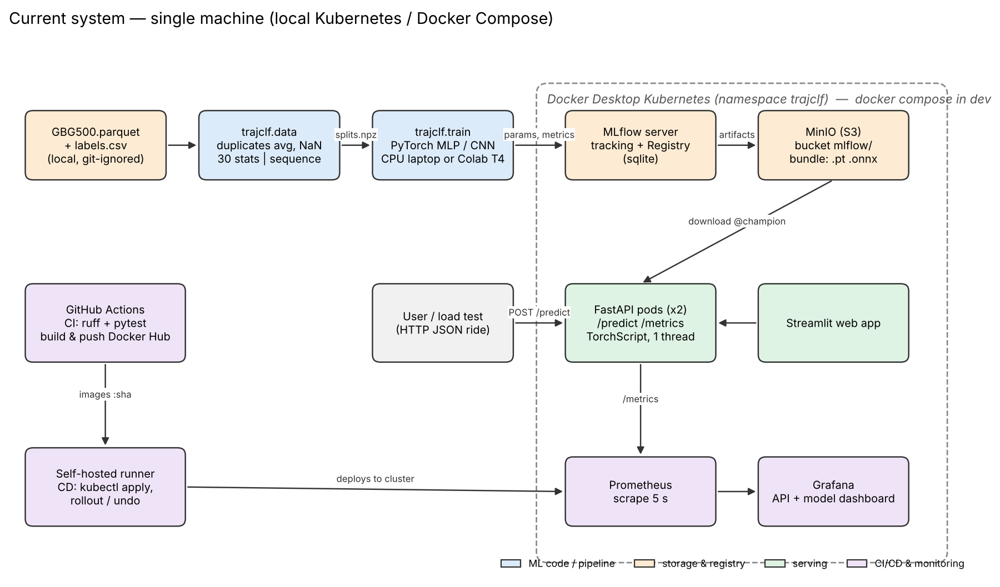
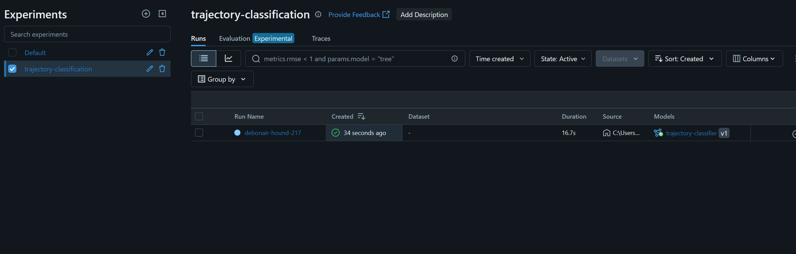
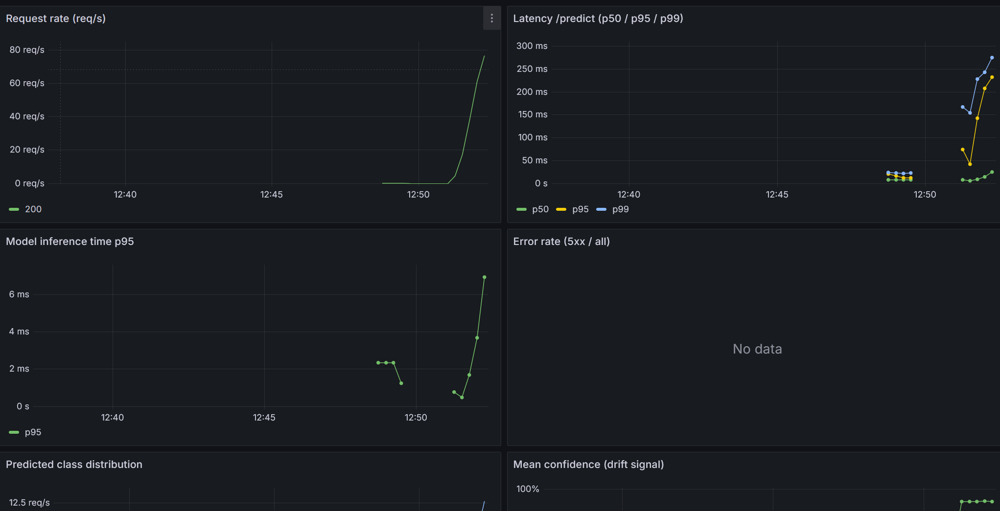

# Ride classification — MLOps pipeline + AI Infrastructure

Classifies e-scooter/bike **rides** (IMU readings: accelerometer `ax ay az`, gyroscope `rx ry rz`)
into 5 classes: **Safe, Safe overall, Bad weather, Tandem, Reckless** (GBG500 dataset, 500 rides).

One repository, two courses:
* **MLOps** — preprocessing, training, MLflow tracking + registry, model storage on S3 (MinIO),
  FastAPI, web app, Docker, Kubernetes, GitHub Actions CI/CD, retraining pipeline, monitoring.
* **AI Infrastructure** — resource sizing, inference benchmark, ONNX/INT8 optimization,
  distributed-training decision, scaling/cost/rollback plan → [`ai-infrastructure/`](ai-infrastructure/README.md).

Team: *Name 1, Name 2, Name 3, Name 4, Name 5*

## Architecture



| Step | Tool | Code |
|---|---|---|
| Data extraction & checks | pandas / pyarrow | `research/inspect_data.py`, `research/check_rides.py` |
| Preprocessing | duplicates averaged, NaN-aware stats, stratified ride split (80/20, seed 42) | `src/trajclf/data.py` |
| Model | PyTorch — `mlp` (30 aggregate features, default) or `cnn` (1024×6 sequence) | `src/trajclf/model.py`, `configs/*.yaml` |
| Tracking & registry | MLflow; best model gets alias `@champion` (macro-F1 gate) | `src/trajclf/train.py` |
| Model storage | MinIO (S3) as MLflow artifact store; bundle = TorchScript + ONNX + preprocessing | `src/trajclf/bundle.py` |
| API | FastAPI + Swagger (`/docs`), Prometheus metrics (`/metrics`) | `src/trajclf/api/main.py` |
| Web app | Streamlit: upload a ride CSV, see signals + prediction | `webapp/app.py` |
| Containers | Docker images api / webapp / train | `Dockerfile.*`, `docker-compose.yml` |
| Production | Docker Desktop Kubernetes: Deployment, Service, HPA, CronJob | `k8s/` |
| CI/CD | GitHub Actions: lint + tests → images on Docker Hub → deploy (self-hosted runner) with auto-rollback | `.github/workflows/` |
| Retraining pipeline (bonus) | data → train → register → promote if better → redeploy | `.github/workflows/retrain.yml`, `pipelines/dags/`, `scripts/retrain.sh` |
| Monitoring (bonus) | Prometheus + Grafana dashboard (latency, errors, class mix, confidence, input drift) | `monitoring/` |

## Technical choices

* **Supervised learning** on GBG500 labels (confirmed with the teacher, see `docs/FINDINGS.md`);
  `SRV3490` (crash data) is not used for the 5-class task.
* **Imbalance** (Safe 416 vs Reckless 6): class-weighted cross-entropy; **macro-F1** as the main
  metric; accuracy alone is misleading (always predicting Safe gives 0.83).
* **Same held-out test split as the research phase** (100 rides), so MLflow runs compare directly
  with `docs/FINDINGS.md`: always-Safe macro-F1 0.18, random forest 0.36, first MLP 0.23
  (exploratory). The pipeline also logs a random-guess baseline to check "better than random".
* **Preprocessing inside the model bundle** (`preprocess.json`): the API and training apply the
  same transformation, so there is no training/serving skew.
* **TorchScript + ONNX export** in every bundle: the API needs no model class, and the runtime can
  be switched (`MODEL_RUNTIME=torch|onnx|onnx-int8`) for the AI-infra optimization.

## Quick start (dev)

```bash
pip install -r requirements-dev.txt
# put Project.zip content in data/raw/  (GBG500.parquet, GBG500_labels.csv) — git-ignored
docker compose up -d minio mlflow     # MinIO :9001, MLflow :5000
make data train                                  # preprocess, train, log, register, promote
docker compose up -d                             # API :8000/docs, web app :8501, Grafana :3000
python scripts/export_sample_rides.py            # test rides as CSV for the web app
```

No data? `make synthetic` generates fake rides with the same schema (for tests only).
Sequence model: `TRAJCLF_CONFIG=configs/config.cnn.yaml make data train`.

## Production (local Kubernetes)

```bash
kubectl apply -k k8s/                            # MinIO, MLflow, API (x2 + HPA), web app, retrain CronJob
kubectl -n trajclf port-forward svc/mlflow 5000 & kubectl -n trajclf port-forward svc/minio 9000 &
make data train                                  # registers @champion in the cluster's MLflow
kubectl -n trajclf rollout restart deploy/trajclf-api
helm install monitoring prometheus-community/kube-prometheus-stack -n monitoring --create-namespace -f k8s/monitoring-values.yaml
```

The CD workflow runs these steps on a self-hosted runner. Configure repository secrets:
`DOCKERHUB_USERNAME`, `DOCKERHUB_TOKEN`, `MINIO_USER`, `MINIO_PASSWORD`.

> **Note on MinIO images.** MinIO withdrew its public images from Docker Hub and quay.io in September
> 2026, so `minio/minio` and `minio/mc` no longer pull. The stack uses `cgr.dev/chainguard/minio`
> (a build of the same MinIO server) and creates buckets with boto3 instead of `mc`.

## Tests

```bash
make test                     # unit + integration (synthetic data, no server needed)
API_URL=http://localhost:8000 pytest -m e2e   # against a running API
```

## Docker images

* API: https://hub.docker.com/r/comebnvl/trajclf-api
* Web app: https://hub.docker.com/r/comebnvl/trajclf-webapp
* Training / retraining job: https://hub.docker.com/r/comebnvl/trajclf-train

## Results

### Model quality (100 held-out test rides, same split as `docs/FINDINGS.md`)

| Model | Macro-F1 | Accuracy | Notes |
|---|---|---|---|
| Random guess | 0.069 | — | logged by `train.py` |
| Always "Safe" | 0.18 | 0.83 | research baseline |
| Random forest (research) | 0.36 | 0.80 | `research/train_baseline.py` |
| **RideMLP — MLflow `trajectory-classifier` v1 (served)** | **0.317** | 0.80 | 4,229 parameters, 1.55 s CPU training |

The served model beats random and the majority baseline. With only 6 Reckless rides in the whole
dataset (1 in the test split), per-class scores for minority classes remain unreliable.

### Experiment tracking and model storage

Run tracked in MLflow; the trained model is registered as `trajectory-classifier` **v1** (Models column) with alias `champion`:



**Model artifacts stored on MinIO (S3 bucket `mlflow`)**


### API (FastAPI + Swagger)


### CI on GitHub Actions

Every pull request runs `.github/workflows/ci.yml`: ruff lint + unit/integration tests (training, ONNX export,
API) on a clean Ubuntu runner. Docker images are built and pushed to Docker Hub only on `main`.


### Production on Kubernetes (Docker Desktop)

`kubectl apply -k k8s/` — MinIO, MLflow, API (2 replicas, rolling update, HPA 2→6), web app, retraining CronJob:


Web app running in the cluster, calling the API pods:


### Autoscaling tested (HPA, metrics-server)

Load test of 16 concurrent clients for 180 s (`load_test.py --tag k8s-hpa`): the HPA scaled the API
**from 2 to 6 pods** (its maximum) because average CPU exceeded the 60 % target; after the load
stopped and the 120 s stabilisation window, it **scaled back down to 2 pods** (CPU 1 %, the 4 added
pods removed, the 2 original pods kept).


`kubectl describe hpa trajclf-api -n trajclf` (excerpt):

```text
Metrics:  resource cpu on pods (as a percentage of request):  65% (164m) / 60%
Min replicas: 2   Max replicas: 6
Deployment pods:  6 current / 6 desired
Events:
  Normal  SuccessfulRescale  horizontal-pod-autoscaler  New size: 6; reason: cpu resource utilization (percentage of request) above target
```

Limitation: the load came through `kubectl port-forward`, which sends all traffic to **one** pod; that
pod ran at its 1-CPU limit (6 × 250m requested × 65 % ≈ 1 CPU) while the new pods stayed idle. The
test validates the **scaling decision**, not load distribution, which needs a real load balancer.

### Monitoring (Prometheus + Grafana) under load




Load test (one API container, `ai-infrastructure/benchmarks/load_test.py`): ≈94 req/s peak at 4
concurrent clients, 0 errors over ≈4,500 requests. Details: [`ai-infrastructure/README.md`](ai-infrastructure/README.md).

## Repository layout

```text
src/trajclf/          package: data, model, train, bundle, predictor, api/
configs/              config.yaml (MLP) · config.cnn.yaml (CNN)
research/             first exploration scripts + saved outputs (RF and MLP baselines)
docs/                 FINDINGS.md, PROJECT_OVERVIEW.md, data.txt
webapp/  k8s/  monitoring/  pipelines/dags/  scripts/  tests/
ai-infrastructure/    sizing, benchmarks, optimization, distributed-training, cost-resilience
```
