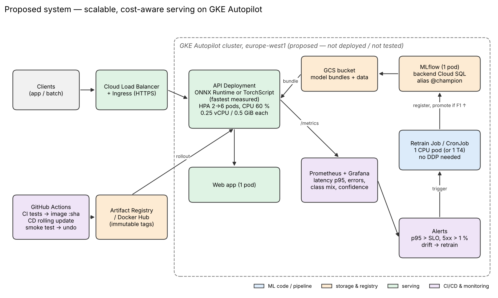

# Serving architecture, scaling, monitoring, costs and recovery

Status legend: **[implemented]** exists in this repo; **[tested]** we ran it and kept the evidence;
**[proposed]** design only — not deployed. Do not upgrade a status without evidence
(screenshot, CSV, command output).

## 1. Serving architecture

| Layer | Choice | Why | Status |
|---|---|---|---|
| API | FastAPI, `/predict`, `/predict/batch`, `/health`, `/metrics` | Swagger UI, Pydantic validation | implemented |
| Model runtime | TorchScript (baseline) or ONNX Runtime (FP32 / INT8), selected with `MODEL_RUNTIME` | choose the fastest one **measured** in `optimization/comparison.ipynb` | implemented |
| Model source | MLflow Registry alias `@champion`, bundle in S3 (MinIO; GCS in cloud) | versioned, rollback = move alias | implemented |
| Hardware | **CPU pods**, 1 intra-op thread each | 4k–94k-parameter model: a GPU would sit idle (see §4) | proposed |
| Orchestration | Kubernetes Deployment, 2+ replicas, rolling update `maxUnavailable: 0` | zero-downtime deploys, self-healing | implemented (local K8s) |

Request path: client → Load Balancer → API pod → preprocessing (30 statistics or resampling)
→ model forward → JSON response. For the MLP, preprocessing and JSON parsing of a ride
(≈3,000 readings × 6 values ≈ 100 kB) probably cost more than the model itself. This is measured
separately: `preprocess-results.csv` and Prometheus `model_preprocess_seconds` vs
`model_inference_seconds`.

## 2. Request-scaling strategy

1. **Capacity per pod (measured).** One API container (1 uvicorn worker) peaks at **≈94 req/s**
   (4 concurrent clients, p95 128 ms) and degrades beyond that (16 clients: 82 req/s, p95 289 ms) —
   `benchmarks/results/load-test.csv`. Planning value with 40 % headroom: **≈55 req/s per pod**.
2. **Horizontal Pod Autoscaler** (`k8s/hpa.yaml`): 2 → 6 replicas, target 60 % CPU, scale-down
   stabilisation 120 s. 2 replicas minimum, for availability.
3. **Pods needed** for a target load *R* req/s: `ceil(R / (0.6 × 94))` = `ceil(R / 56)`; e.g. 200 req/s → 4 pods, the HPA maximum of 6 pods ≈ 340 req/s.
4. **Batch endpoint** `/predict/batch` (up to 256 rides) for offline scoring: amortises HTTP/JSON overhead.
5. **Test it** (required before claiming it): run `load_test.py --concurrency 1 4 16 32` against
   the local cluster, then in parallel `kubectl get hpa -n trajclf -w`. Save the output and a Grafana
   screenshot. Docker Desktop needs metrics-server:
   `kubectl apply -f https://github.com/kubernetes-sigs/metrics-server/releases/latest/download/components.yaml`
   then patch `--kubelet-insecure-tls`.

## 3. Monitoring (4 layers)

| Layer | Signals | Where |
|---|---|---|
| Infrastructure | pod CPU / memory, restarts, HPA replicas | kube-prometheus-stack (`k8s/monitoring-values.yaml`) |
| API | request rate, p50/p95/p99 latency, 4xx/5xx rate | `api_requests_total`, `api_request_latency_seconds` |
| Model | inference vs preprocessing time, predicted class mix, mean confidence, loaded version | `model_*` metrics, `model_info` |
| Data | readings per ride (input drift), share of `Safe` predictions vs 83 % training prior | `input_trajectory_points`, `model_predictions_total` |

Dashboard: `monitoring/grafana/dashboards/trajclf.json`. Suggested alerts: p95 > 2 × the
benchmark p95 for 5 min; 5xx > 1 %; mean confidence or class mix drifting from the training
distribution for 24 h → trigger `retrain.yml`.

## 4. Approximate monthly cost (GKE Autopilot, proposed)

**Assumptions** (all explicit; change them and recompute):
* Region europe-west1, on-demand list prices, 730 h/month, USD.
* GKE Autopilot general-purpose pods are billed by requested resources: $0.0445 per vCPU-hour and
  $0.0049225 per GiB-hour (list price; check the regional price in the GCP pricing calculator).
* Cluster management fee: $0.10/h per cluster, offset by the GKE free tier of $74.40/month per
  billing account (one Autopilot cluster).
* API pods request 0.25 vCPU / 0.5 GiB (Autopilot minimum, to validate with measured RSS).
* Peak: +4 API pods 4 h/day. Retraining: 1 vCPU / 2 GiB, 15 min per week.
* Not priced: storage (GCS/PD, a few GB), Cloud SQL (or sqlite on a PD), load balancer, egress.

| Workload | vCPU | GiB | Pods | Hours/month | USD/month |
|---|---|---|---|---|---|
| API baseline | 0.25 | 0.5 | 2 | 730 | 19.84 |
| API peak extra pods | 0.25 | 0.5 | 4 | 120 | 6.52 |
| Web app | 0.25 | 0.5 | 1 | 730 | 9.92 |
| MLflow | 0.5 | 1 | 1 | 730 | 19.84 |
| Prometheus | 0.5 | 2 | 1 | 730 | 23.43 |
| Grafana | 0.25 | 0.5 | 1 | 730 | 9.92 |
| Retraining job | 1 | 2 | 1 | ≈1.1 | 0.06 |
| Cluster fee | | | | | 0 (free tier) |
| **Total** | | | | | **≈ $90 / month** |

**GPU alternative (rejected):** a single NVIDIA T4 costs $0.35 per GPU-hour on demand (US-region
list price, before the VM's vCPU and RAM), i.e. ≈ $255/month for the GPU alone if always on —
roughly 13× the API's CPU cost, for a model that the CPU serves in milliseconds (to confirm with
the measured latency).

**Serverless alternative:** Cloud Run, request-based billing: $0.000024 per vCPU-second,
$0.0000025 per GiB-second and $0.40 per million requests, with 180,000 vCPU-seconds,
360,000 GiB-seconds and 2 million requests free each month. Assuming 1 vCPU / 0.5 GiB, concurrency 1 and
50 ms per request: 1 M requests/month ≈ $0 (inside the free tier); 10 M requests/month ≈ $11.
It scales to zero, so it is cheaper than GKE for low or irregular traffic. Costs: cold starts
(model download at start-up), and less control over monitoring and rollback.

**Cost controls:** budget alert at 50/90/100 % (alerts do not stop spending); delete the
cluster after demos; `minReplicas: 1` outside demo hours; Spot pods for the retraining job.

## 5. Recovery and rollback

| Failure | Detection | Recovery | Status |
|---|---|---|---|
| Pod crash / OOM | liveness probe, restarts metric | Kubernetes restarts the pod; 2 replicas keep serving | implemented |
| Bad code or image | CD `rollout status` timeout, e2e smoke test | `kubectl rollout undo deploy/trajclf-api` (automatic in `cd.yml`); images tagged by commit SHA | implemented, *test it once and keep the log* |
| Bad model version | macro-F1 gate (new model promoted only if F1 > champion); confidence/class-mix alerts | move the alias back: `client.set_registered_model_alias("trajectory-classifier", "champion", <previous_version>)` then `kubectl rollout restart deploy/trajclf-api` | implemented |
| MLflow / MinIO down | API start-up fails | running pods keep the loaded model in memory; `MODEL_DIR` fallback to a bundle baked into the image | proposed |
| Data loss | — | MinIO/GCS bucket versioning; MLflow DB backups (PVC snapshot or Cloud SQL backups) | proposed |

Rollback drill (do once, record the time-to-recover): deploy an image with a broken
`/health`, check that CD rolls back automatically, and note the duration from the
`kubectl rollout history` timestamps.
